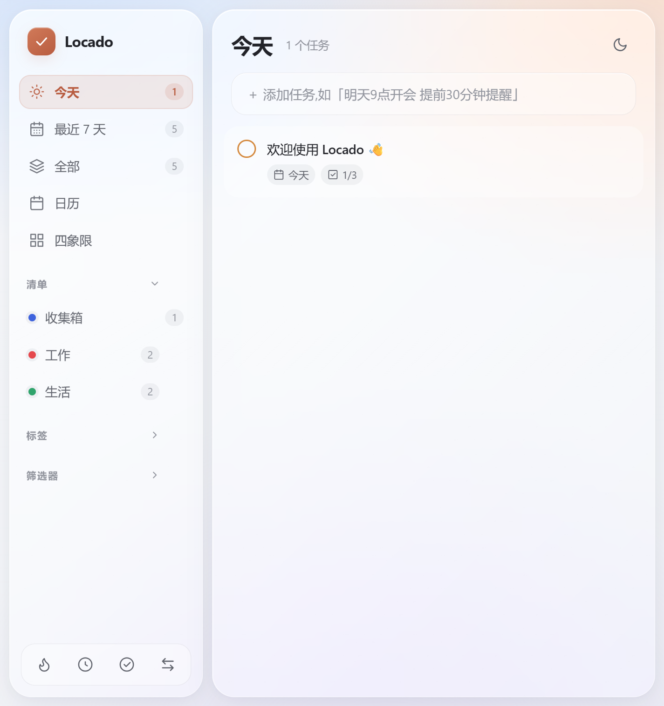

# Locado

**English | [简体中文](README.zh-CN.md)**

A local-first task manager for planning, habits, and focused work. Capture tasks in natural language, organize them your way, and work offline with an installable PWA—no account, tracking, or backend required.

[](https://github.com/Maobuchiyugutou/locado/actions/workflows/ci.yml)
[](LICENSE)
[](https://nodejs.org/)



## Features

- **Natural-language Quick Add**: turn one sentence into a task with dates, times, projects, tags, priority, reminders, and recurrence. Review every parsed field before saving.
- **Flexible organization**: manage projects, subtasks, notes, pins, and recurring tasks with daily, weekly, monthly, yearly, or after-completion rules.
- **Purposeful views**: plan with Today, Next 7 Days, calendar, custom filters, and a drag-and-drop Eisenhower matrix.
- **Habits and focus**: track daily habits and run task-linked Pomodoro sessions that survive reloads.
- **Local-first PWA**: work offline with light/dark themes, keyboard navigation, and no account or telemetry.
- **Portable data**: import TickTick CSV, export JSON, and restore from five rotating local backups with previews.

## Quick start

Clone the repository:

```bash
git clone https://github.com/Maobuchiyugutou/locado.git
cd locado
```

Run the launcher for your operating system:

**Windows**

```bat
scripts\run-windows.cmd
```

**macOS**

```bash
bash scripts/run-macos.sh
```

**Linux**

```bash
bash scripts/run-linux.sh
```

The launcher checks for Node.js 24+, installing it through winget on Windows or a user-local nvm on macOS/Linux. It then builds the production app and opens [http://localhost:1420](http://localhost:1420).

Keep the terminal open and press `Ctrl+C` to stop. These launchers run the Web/PWA version; Rust and native build dependencies are not required.

## Data and reminders

Locado stores data in the browser or Tauri WebView's `localStorage`. Task data is never uploaded to a server.

- Export an independent JSON backup regularly via **Import / Export**. The five automatic backups use the same local storage and do not replace an exported copy.
- Keep using `http://localhost:1420`. Browser data is isolated by origin, so changing the hostname or port will use a different data store. Export before clearing site data or switching browsers.
- Browser/PWA and desktop data are stored separately; migrate between them with JSON export and import.
- Reminders are checked only while Locado is running. Closing the app stops reminder checks; there is no background notification service.

## Development

With Node.js 24 or newer installed:

```bash
npm ci
npm run dev
```

Open [http://localhost:1420](http://localhost:1420). To run regression tests and verify a production build:

```bash
npm test
npm run build
npm run preview -- --host 127.0.0.1 --port 1420 --strictPort
```

## Project structure

```text
src/                 Application, UI, storage, and natural-language parsing
src-tauri/           Tauri 2 desktop shell
public/              PWA manifest, service worker, and icons
tests/               Node.js regression tests
scripts/             Cross-platform launchers and WSL development scripts
docs/                Guides, distribution plan, and screenshots
.github/             CI, issue forms, and pull request template
```

## Documentation and community

- [Windows + WSL guide (中文)](docs/zh-CN.md)
- [Native app and distribution status (中文)](docs/distribution-plan.md)
- [Planned work](https://github.com/Maobuchiyugutou/locado/issues)
- [Contributing guide](CONTRIBUTING.md)
- [Changelog](CHANGELOG.md)
- [Security policy](SECURITY.md)
- [Report a bug](https://github.com/Maobuchiyugutou/locado/issues/new?template=bug_report.yml) · [Request a feature](https://github.com/Maobuchiyugutou/locado/issues/new?template=feature_request.yml)

## License

[MIT](LICENSE) © 2026 Maobuchiyugutou
