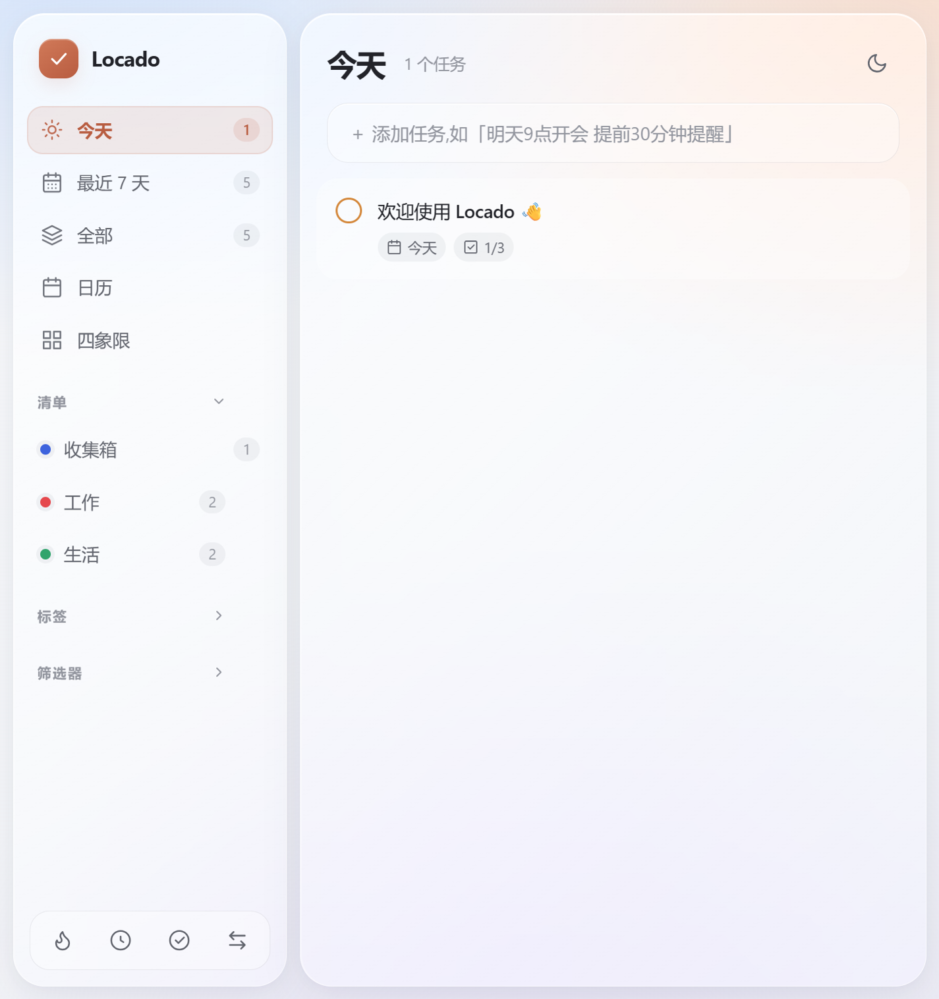

# Locado

**[English](README.md) | 简体中文**

Locado 是一个本地优先的待办工具，支持清单、标签、四象限、习惯打卡、专注番茄钟，以及可安装、可离线运行的 PWA。

基于 Vite 和 TypeScript 构建，不依赖 UI 框架。数据保存在本机，可随时导出备份。

[](https://github.com/Maobuchiyugutou/locado/actions/workflows/ci.yml)
[](LICENSE)
[](https://nodejs.org/)



## 功能特点

- **自然语言 Quick Add**：一句话识别日期、时间、清单、标签、优先级、提醒和重复规则，可在创建前逐项纠正解析结果。
- **完整的任务管理**：清单、标签、子任务、备注、优先级、提醒、置顶，以及独立的重要性和紧急度。
- **重复任务**：支持每天、每周、每月、每年和完成后若干天，完成当前任务后生成下一次任务。
- **多种规划视图**：今天、最近 7 天、全部、已完成、日历、自定义筛选器和可拖拽的四象限。
- **习惯与专注**：每日习惯打卡，以及可关联任务、刷新后自动恢复的番茄钟。
- **本地优先、支持离线**：无需账号、遥测或后端，支持安装 PWA 并离线工作。
- **数据可迁移**：JSON 备份与恢复、滴答清单 CSV 导入，以及最新 5 份本地备份和恢复预览。
- **桌面端体验**：浅色/深色主题、液态玻璃界面、键盘导航和无障碍弹窗。

**提醒边界：** 提醒只在 Locado 运行时检查和投递。关闭浏览器标签页、PWA 或原生窗口后不再检查提醒；当前不提供后台常驻通知服务。

## 普通用户使用

当前可从源码运行浏览器/PWA 版本。Tauri 2 原生壳已在 `src-tauri` 配置并复用现有前端，但 Windows、macOS 和 Linux 安装包尚未发布，原生逐平台验收仍在进行，不提供虚假下载链接。

全平台安装包、签名和发布计划见 [全平台分发规划](docs/distribution-plan.md)。后续正式下载页会区分普通用户与开发者，不要求安装 Node.js 或 WSL。

## 从源码运行

### 一键安装运行（推荐）

先克隆仓库：

```bash
git clone https://github.com/Maobuchiyugutou/locado.git
cd locado
```

Windows：双击 `scripts\run-windows.cmd`，或在命令行运行：

```bat
scripts\run-windows.cmd
```

macOS：

```bash
bash scripts/run-macos.sh
```

Linux：

```bash
bash scripts/run-linux.sh
```

脚本会检查 Node.js 24：Windows 使用 winget 安装，macOS/Linux 使用用户目录中的 nvm 安装。随后自动执行 `npm ci`、生产构建并打开 [http://localhost:1420](http://localhost:1420)。保持终端运行，按 `Ctrl+C` 停止服务。此模式使用 Web/PWA，不需要安装 Rust 或原生编译依赖。

**普通 Windows 用户不需要 WSL。** WSL 只是当前开发电脑的特殊环境方案。

### 手动运行

已安装 Node.js 24 或更新版本时，也可以直接执行：

```bash
npm ci
npm run dev
```

打开 [http://localhost:1420](http://localhost:1420)。

### 生产构建

```bash
npm run build
npm run preview -- --port 1420 --strictPort
```

### 自动化测试

```bash
npm test
npm run build
```

测试覆盖中文自然语言日期、CSV 导入、旧快照兼容、本地存储、番茄记录幂等和损坏数据恢复。

当前电脑的一键 Windows + WSL 流程见 [中文使用与 WSL 指南](docs/zh-CN.md)。

## 数据与隐私

Locado 当前将数据快照保存在浏览器或 Tauri WebView 的 `localStorage` 中，不会把任务数据上传到服务器。

- 定期通过“导入 / 导出 → 导出 JSON 备份”保存数据。自动备份仍在同一本地存储中，不能替代独立导出的副本。
- 自动保留最新 5 份本地备份（含恢复前保护）。恢复列表会预览备份时间和任务/清单/标签数量，确认后才替换当前数据。
- 浏览器数据按 origin 隔离，请固定使用 `http://localhost:1420`，不要在 `localhost`、`127.0.0.1` 或不同端口之间切换。
- 清理站点数据或更换浏览器前，请先导出备份。
- 浏览器与原生应用的数据空间不同，迁移时通过 JSON 导出和导入完成。

## 项目结构

```text
src/                 应用、存储、解析与界面
public/              PWA manifest、Service Worker 和图标
tests/               Node.js 回归测试
scripts/             三平台一键运行与 WSL 开发脚本
docs/                使用指南、分发规划和应用截图
.github/             CI、Issue 表单和 PR 模板
```

## 开发规划

- [全平台原生安装包与发布流水线](docs/distribution-plan.md)
- Tauri + SQLite 存储适配器
- 移动端导航与窄屏布局
- 可重复运行的浏览器端到端测试
- 更多导入与导出格式

## 社区文档

- [贡献指南](CONTRIBUTING.md)
- [安全策略](SECURITY.md)
- [更新日志](CHANGELOG.md)

## 许可证

[MIT](LICENSE) © 2026 Maobuchiyugutou
